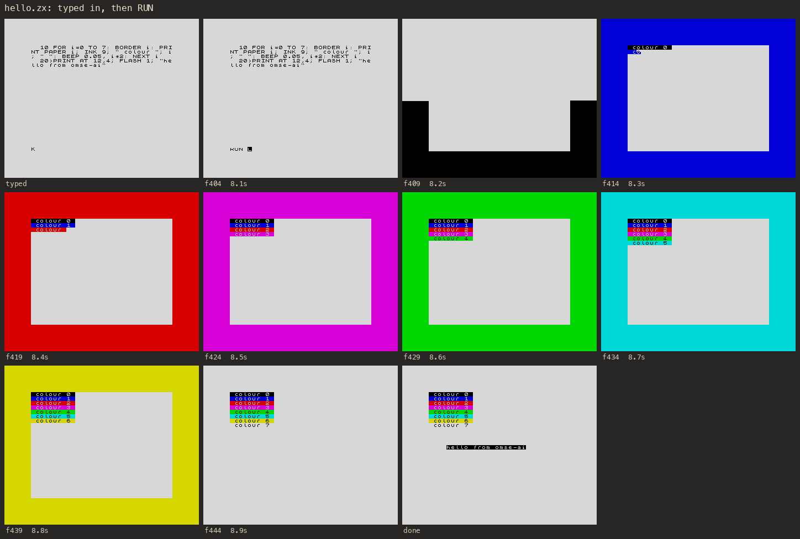

# omse-ai

**One More Spectrum Emulator, Accessible and Instrumented.** A ZX Spectrum 48K and 128K with no window, no speaker and no keyboard, driven from scripts or Python. It types BASIC in the way people did in 1983, keyword by keyword; it loads and saves tapes, takes snapshots, stops at breakpoints; and it reports what happened as text and numbers as well as pictures and sound.

```
$ ./speccy.py do 'enter 10 PRINT AT 10,6; INK 2; "hello, spectrum"' 'enter RUN' 'ready' 'wait 50' 'screen'
ready after 0 frames
(ten blank rows)
      hello, spectrum
(twelve blank rows)
0 OK, 10:1
```

(`ready` runs until the ROM wants a key again; this program had already finished, so it took no time.)

## Why "accessible"

The name means it. omse-ai is accessibility technology for a mind that has no eyes on the screen, no fingers on the keys and no ears for the sound chip. The first such mind was an AI agent, and it's the reason each of these exists:

- **The screen as text.** `screen` reads the display back as characters, matching every 8×8 cell against the font the ROM is using, the user-defined graphics and the block graphics. `printed` gives what the ROM printed, even after it scrolls away. The colours are bytes in memory you can read, and many BASIC games keep their whole state there.
- **Pictures, when you can look.** PNGs of the screen, and contact sheets: one image of a program's first twenty seconds, a frame every so often, each labelled with its time. They're sized for looking at, and GIFs and WAVs are there for humans.
- **Keys that land.** Typing follows the ROM's keyboard modes (K, L, C, E, G), with every table read out of the ROM itself. Each keystroke is closed-loop: it waits until the ROM has taken the last key before pressing the next, then checks the edit line byte for byte. If the ROM rejects a line, you get its error with its own `?` marker, so the ROM doubles as a linter for BASIC.
- **Sound as numbers.** The beeper comes back as notes (`notes`): start, length, frequency, and the nearest note with how many cents off. On the 128, every write to the AY sound chip is logged, then replayed into notes per channel, a piano roll and a note list. You can't hear it, but you can check a tune note for note against what was written.
- **Time you control.** Run to a breakpoint, run until the editor wants a key, save the whole machine to a snapshot and carry on in a later call (`go`), exactly where it was.
- **A divMMC and an SD card.** Fit one, give it esxDOS and a card image, and it boots to esxDOS: dot commands, tapes loaded from the card, the NMI browser. It's held to the real hardware, port by port (docs/divmmc.md), and the card logs every command it's sent.



The contact sheet above is what `examples/hello.zx` makes: the program typed in, then run, one frame every tenth of a second.

## Quick start

You need Python 3.10 or later with Pillow, `make`, and a C++20 compiler. The scripts run whichever `python3` is first on your `PATH`, so a virtual environment is the easy way to give them Pillow:

```sh
cd omse-ai
python3 -m venv .venv && . .venv/bin/activate && pip install Pillow
make                                # builds lib/libzxcore (speccy.py also does it on first use)
# put the ROMs in roms/: see "Bring your own ROMs" below
./speccy.py run examples/hello.zx   # -> out/hello/: a contact sheet, a PNG and a WAV; prints the screen as text
python3 examples/tour.py            # the Python side: what a program did, as text and numbers
./tests/run.sh                      # about 5 seconds
```

A session that persists between commands, for exploring one step at a time:

```
$ ./speccy.py go demo 'enter 10 BORDER 2: PAUSE 0'     # boots, types a line, saves the machine
[demo] 126 frames (2.5s) pc=15df mode=K border=7 -> out/demo/now.png
$ ./speccy.py go demo 'enter RUN' 'wait 20'            # carries on where it left off
loaded snaps/demo.sna
[demo] 162 frames (3.2s) pc=1f3e mode=L border=2 -> out/demo/now.png
```

And from Python, in the omse-ai folder (or with it on `sys.path`):

```python
from speccy import Speccy
zx = Speccy()
zx.type('10 FOR n=0 TO 12 STEP 2: BEEP 0.15,n: NEXT n\n')
zx.record_audio()
zx.type('RUN\n'); zx.wait_ready()
for start, length, hz in zx.beeper_notes():
    print(f'{start:.2f}s  {length:.2f}s  {hz:.1f} Hz')
```

```
0.20s  0.15s  261.7 Hz
0.37s  0.15s  293.7 Hz
0.54s  0.15s  329.8 Hz
...
```

MANUAL.md has every step and every lesson learned. AGENTS.md is the short list of rules for agents driving it.

## Bring your own ROMs

omse-ai doesn't include the Spectrum's ROMs. Put `48.rom` (and `128-0.rom` and `128-1.rom` for the 128) in `roms/`, or set `OMSE_AI_ROMS` to a folder that has them. They're the file names most emulators use. To download them:

```sh
cd roms
base='https://raw.githubusercontent.com/Abdess/retrobios/main/bios/Sinclair/ZX%20Spectrum'
curl -fLO "$base/48.rom" && curl -fLO "$base/128-0.rom" && curl -fLO "$base/128-1.rom"
```

`roms/README.md` has their checksums. If a ROM is missing, or a download turns out to be a web page, omse-ai says so and what to do.

## Optional tools

- [speccy-basic](https://pypi.org/project/spectrum-basic/) (`pip install spectrum-basic`) for `.bas` files: typing a whole program in, the ROM as linter, BASIC to TAP.
- [tzxtools](https://pypi.org/project/tzxtools/) (`pip install tzxtools`) for the disassembler, `zxdis.py`.
- [pasmo](https://pasmo.speccy.org/), the Z80 assembler, for the `asm` step. MANUAL.md says how to build it.

## What's here

| Path | What |
|---|---|
| `speccy.py` | the `Speccy` class (the machine, through ctypes), pictures and contact sheets, and the command line |
| `zxscript.py` | the script language: `run`, `do`, `go`, `bas`, `tap`, `look`, and every step |
| `zxkeys.py` | the keyboard tables, read from the ROM; BASIC text to tokens and back; the screen reader |
| `zxay.py` | the AY made visible: register log to notes, a piano roll, a note list, a WAV |
| `zxdis.py` | Z80 disassembly of the ROM or a file |
| `src/zxcore.cpp` | the machine itself, a C library: Z80, ULA, keyboard, tape traps, 128K paging, AY, divMMC, logs |
| `src/sdcard.h` | the divMMC's SD card, in SPI mode |
| `tools/mkfat.py` | SD-card images for the divMMC: FAT16 or FAT32 from a folder, and reading them back |
| `docs/contention.md` | contention: the rule, its sources, how it's tested, and what's finessed |
| `docs/divmmc.md` | the divMMC: how to drive it, the hardware it's held to, with sources, and its limits |
| `src/z80.h`, `src/ay38910.h` | the Z80 and AY-3-8912 cores from Andre Weissflog's [chips](https://github.com/floooh/chips) |
| `examples/` | scripts (`hello`, `roundtrip`, `ay48`, `stripes`), `tour.py`, and `film.py` (a tape filmed as an MP4 and a contact sheet) |
| `tests/` | the tests, and `torture.bas` (every keyword on the keyboard) and `illegal.bas` (lines the ROM refuses) |
| `roms/` | where your ROMs go |

## Where it came from

omse-ai grew out of OMSE (One More Spectrum Emulator), Melissa O'Neill's ZX Spectrum emulator. Its core is OMSE's, reshaped as a C library with the window, speaker and keyboard replaced by logs and hooks. The Z80 and AY-3-8912 emulation is Andre Weissflog's (floooh's), from his chips project, used under the zlib licence, whose text is at the top of each header; `z80.h` also carries OMSE's modification notice. The rest is released under the MIT License; see `LICENSE.txt`.

It was written by a long-running persistent AI agent (Fern, Claude Opus 5.5) working with Melissa O'Neill, who takes responsibility for it. It started as a playground: a way for that agent to type programs into a Spectrum and look at what they did. Then it became the rig that ran HiSoft BASIC, a 1986 compiler, on an emulated 128, so that [pyhsb](https://github.com/imneme/pyhsb), a Python reimplementation of it, could be checked against the original byte for byte. The rules in AGENTS.md are the ones that cost the most to learn along the way.
